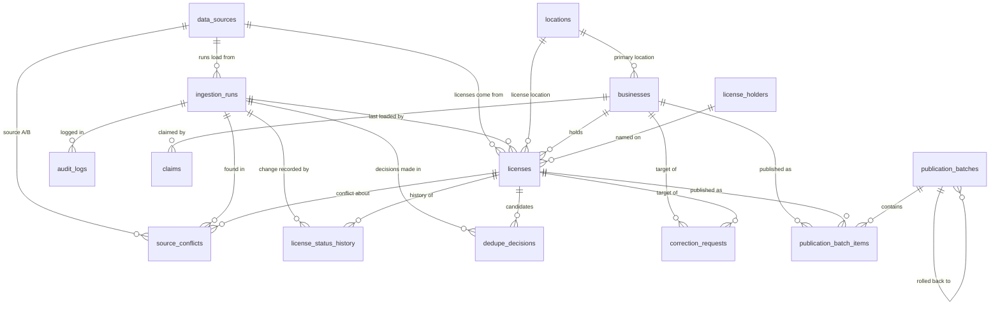

# Data Model — House Craft Pros (Sprint 01)

**Status:** proposed (Sprint 01) · **Date:** 25/11/2026
**Spec:** `docs/spec-mvp-texas-v2.md` §4 (DB v2 = 11 tables) · Sprint 01
`docs/specs/sprint-01/spec.md` (US2/US4/US6/US9), `plan.md`, `tasks.md` (T010)
**Evidence base:** `research/data-findings-2026-11-24.md` (verified 24/11/2026)
+ header/field analysis of the Nov-24 local CSV copies (headers + aggregate
null-rates only; no personal rows copied into the repo).

**Canonical sources of this model (in priority order):**
1. `etl/contract/normalized-record.v1.json` — JSON Schema for the normalized
   record (language-independent contract).
2. `db/migrations/*.sql` — PostgreSQL DDL (the persisted shape).
3. This document — the human-readable model.
4. `docs/architecture/data-dictionary.md` — every column, with source mapping.
5. `docs/architecture/data-contract.md` — interfaces + versioning rules.

**TypeScript types are DERIVED from (1) and (2), never the standard.** A `.ts`
type that disagrees with the JSON Schema or the DDL is wrong; fix the type.
(Why: the backend is designed to move to Rust later — ADR-0001 — and a
TypeScript-only contract would not survive the swap.)

**PostgreSQL is the canonical source** (ADR-0002). Migrations target
PostgreSQL 16. Any stand-in used for a dry-run (e.g. SQLite) is a stand-in,
never the contract. The migrations in `db/migrations/` were executed against a
real local PostgreSQL 16.15 on 25/11/2026 — see §9 for the exact outcome.

---

## 1. Entity-relationship diagram

Notes on the diagram:
- `dedupe_decisions.license_ids` is a `uuid[]` (candidate license ids), not a
  join table: a decision groups 2+ candidate licenses, and the array preserves
  the exact cluster the decision was made about. The FK to `businesses` is set
  only when `decision = 'merged'`.
- `license_status_history` is append-only; `audit_logs` is append-only.
- `claims` and `correction_requests` hold requester contact details and are
  never exposed publicly (no view, no anon access).

## 2. Tables — overview

14 tables: the 11 from spec v2 §4, plus 3 proposed in §5 (each with a technical
reason). No other tables exist in Sprint 01.

| # | Table | Purpose | Rows at MVP scale (est.) |
|---|---|---|---|
| 1 | `data_sources` | Government sources we ingest (agency, file, status-field flag) | 3 (seeded) |
| 2 | `locations` | State / county / city reference | ~254 counties + cities as loaded |
| 3 | `license_holders` | Person named on the license | ≤ #licenses |
| 4 | `ingestion_runs` | One row per ETL download+load attempt (audit anchor) | 3/day + retries |
| 5 | `businesses` | Deduped business identity | < #licenses (dedupe result, TBD in dry-run) |
| 6 | `licenses` | One row per government license (the normalized record, persisted) | ~44,980 rows in the 24/11/2026 files (14,067 elec + 20,497 HVAC + 9,416 RMP) |
| 7 | `license_status_history` | Every status/verification change + disappearance | ≥ #licenses (genesis row each) |
| 8 | `claims` | Business-claim requests (manual phone verification) | 0 at launch |
| 9 | `correction_requests` | Correct/remove requests | 0 at launch |
| 10 | `publication_batches` | Publication events, one per gate opening | grows per batch |
| 11 | `publication_batch_items` | **PROPOSED** — per-record batch membership (rollback) | grows per batch |
| 12 | `audit_logs` | Append-only change evidence | grows with ETL/admin actions |
| 13 | `dedupe_decisions` | **PROPOSED** — every dedupe decision + held clusters | grows per run |
| 14 | `source_conflicts` | **PROPOSED** — cross-source disagreements, both values kept | 0 unless sources disagree |

## 3. Table descriptions

### 3.1 `data_sources`
One row per government source file. Columns that matter: `code` (stable key:
`tdlr-electrical`, `tdlr-hvac`, `tsbpe-rmp`), `agency`, `trade`, `file_name`,
`source_url` (exact file URL when known — NULL until confirmed, never guessed),
`landing_page_url` (human-verifiable .gov page), `license_type_label`,
`has_status_field`. **The load-bearing flag is `has_status_field`:** FALSE
forces the loader to derive status from the expiration date and set
`verification_level = 'inferred'` — never `'authority-confirmed'`. Seeded by
migration 0006 (3 rows, values taken from the research findings).

### 3.2 `locations`
State / county / city reference. `city_name` NULL means a county-level
location — the only granularity HVAC data supports (TDLR A/C CSV: business
city/address/phone/ZIP all 0%; county 96%). Uniqueness is
`(state_code, county_name, city_name)` with `NULLS NOT DISTINCT`, so
`(TX, 'Travis', NULL)` is one row. Rows are created by the ETL from source
data; county lists are never hand-seeded (no invented geography).

### 3.3 `license_holders`
The person named on the license (TDLR `NAME`; RMP `LAST_NAME` / `FIRST_NAME` /
`MIDDLE_NAME` / `SUFFIX`). Kept apart from `businesses` because one person can
hold several licenses. No UNIQUE constraint: source name spellings vary and
holder dedupe is out of Sprint 01 scope (see §10). Holder personal names are
NOT in any public view — the Verify tool displays the business name.

### 3.4 `ingestion_runs`
One row per ETL download+load attempt — the traceability anchor (US1/US5).
Records: `source_id`, `contract_version` (`'v1'` — every run records which
contract version produced its records), `status` (`running` / `succeeded` /
`failed` / `blocked_anomaly`), `source_url` (exact URL actually downloaded),
`file_date`, `sha256_checksum` (of the downloaded bytes), row counts
(downloaded / parsed / loaded / new / changed / disappeared), `started_at` /
`finished_at`, `error_message`. Uniqueness: `(source_id, sha256_checksum)` —
re-ingesting the same file is detected and must be a no-op (US5).

### 3.5 `businesses`
Deduped business identity. `name` (as printed), `normalized_name` (lowercased,
punctuation-stripped — the dedupe/search key), `slug` (set at publication
time; NULL until then), `phone` + `phone_normalized` (digits only),
address/city/state/ZIP/county, `location_id`, `dedupe_status` (`single` /
`merged` / `ambiguous_held`), `phone_withheld_for_legal_review` (TRUE hides
the phone from every public view until a lawyer review clears republication of
a sole-proprietor personal phone — spec v2 §6.5; set only by human/legal
review, never by the ETL), the two gate timestamps (§4), `first_seen_run_id` /
`last_seen_run_id`. **Business count is always smaller than license count**
(one business, many licenses) — the exact number is a dry-run result, not a
spec number.

### 3.6 `licenses`
One row per government license — the persisted normalized record (see
`etl/contract/normalized-record.v1.json`). Identity:
**UNIQUE `(source_id, license_type, license_number)`**.
Fields: `business_id`, `holder_id`, `source_id`, `ingestion_run_id`,
`contract_version` (denormalized from the run, for queryability), `trade`,
`license_type` (as printed), `license_subtype` (TDLR only; NULL for RMP),
`license_number` (length varies 1–6 chars — never assume a fixed length),
`expiration_date`, `issue_date` (RMP only), the split (§3.6.1),
`endorsements` (JSONB array, RMP `MEDGAS`/`MRF`/`WS`), `insurance_company` /
`insurance_expiry_date` (RMP only), `county` (denormalized for lookup),
`location_id`, `disappeared_from_source` + `disappeared_at`, the two gate
timestamps (§4). **Expired licenses are loaded and kept queryable** — never
filtered out before load (the v1 mistake).

#### 3.6.1 THE SPLIT — `license_status` vs `verification_level` (US2)

Two separate columns on the same row. The split is a modeling fact, not a join.

| Column | Question it answers | Values | Source |
|---|---|---|---|
| `license_status` | What is the license's own status? | `active` / `expired` / `suspended` / `revoked` / `cancelled` / `pending` / `inactive` / `unknown` | Authority, or derived from expiration date |
| `verification_level` | How confident are WE in that status? | `authority-confirmed` / `inferred` / `unverified` | Our evidence for the status value |

Rules:
- **TDLR CSVs have NO status field.** Status is derived from the expiration
  date (`active` if not expired, `expired` if past, `unknown` if no date) and
  `license_status_source = 'expiration_date'`, `verification_level = 'inferred'`
  — ALWAYS. The DB enforces this with CHECK `licenses_inferred_rule`:
  `license_status_source = 'expiration_date'` can never pair with
  `verification_level = 'authority-confirmed'`. The JSON Schema enforces the
  same invariant with `if/then`. The loader must reject a violating record
  before loading.
- **TSBPE RMP HAS a status field** (`LIC_STATUS`: `Current` / `Expired`).
  `license_status` reflects it (`Current` → `active`, `Expired` → `expired`),
  `license_status_source = 'source_field'`, and `verification_level` may be
  `'authority-confirmed'` — **for the status value itself only, never for the
  business's identity**.
- **Display rule:** nothing carries a "Verified" label unless
  `verification_level = 'authority-confirmed'` with recorded evidence.
  Display wording: "License status as reported in [source] on [date]" + link
  to the .gov lookup page.
- `license_status_source` (`source_field` / `expiration_date` / `gov_lookup` /
  `unknown`) records HOW the status was derived; `status_as_of` records the
  date the statement is true as of (source file date, else run date).

### 3.7 `license_status_history`
Every status/verification change for a license, including the initial load
(`previous_*` NULL, `change_reason = 'initial_load'`) and
disappearance/reappearance. A row is appended exactly when the status or
verification level changes — unchanged records get NO new row (idempotency,
US5). Append-only in practice (no UPDATE/DELETE grants for `app_admin`).

### 3.8 `claims`
Business-claim requests. Verified by MANUAL phone call only (never bulk SMS —
TCPA + Texas SB 140). Deliberately NO email column: the claim form must not
collect excess email (spec v2 §6.5). `status`: `pending` / `in_review` /
`verified` / `rejected`; `verified` requires `verified_at` (CHECK).

### 3.9 `correction_requests`
Requests to correct or remove data (including the Remove Listing page).
`request_type`: `correction` / `removal` / `other`. At least one of
`business_id` / `license_id` must be set (CHECK). A removal request never
deletes the license row outright — removal is a publication-gate decision
(clear the gate timestamps), preserving history.

### 3.10 `publication_batches`
One row per publication event. The batch opens one or both gates for its
member records (§4). `gate_scope`: `data` / `seo_index` / `both`; `status`:
`draft` / `approved` / `published` / `rolled_back`; `record_count`;
`data_published_at` / `seo_index_published_at` (batch-level timestamps);
`rolled_back_at` / `rolled_back_to_batch_id` (rollback pointer).

### 3.11 `publication_batch_items` — PROPOSED (see §5)
Which record, which batch, which gate — the precise membership that makes
rollback exact.

### 3.12 `audit_logs`
Append-only evidence of changes: `actor` (`etl` / `admin:<id>` / `system`),
`action`, `table_name`, `record_id`, `old_values` / `new_values` (JSONB),
`run_id`. UPDATE/DELETE revoked for `app_admin` — history is never rewritten.

### 3.13 `dedupe_decisions` — PROPOSED (see §5)
The record of every dedupe decision (US3).

### 3.14 `source_conflicts` — PROPOSED (see §5)
Cross-source disagreements, both values kept (US4).

## 4. The two publication gates (US8 / plan.md)

**Definitions (from plan.md, adopted unchanged):**
- **Gate 1 — `data_publication`:** the record is visible in the Verify tool /
  directory data.
- **Gate 2 — `seo_index_publication`:** the record's URL is in the sitemap
  index and indexable.

**Design adopted (plan.md's design, implemented as specified):**
- `publication_batches` gains `data_published_at` and
  `seo_index_published_at` (batch-level: when this batch opened each gate).
- Per-record gate state lives ON the `licenses` and `businesses` rows as
  independent nullable timestamps: `data_published_at` and
  `seo_index_published_at`. Non-NULL = gate open for that record. Because the
  two timestamps are independent columns, one record can be data-published
  without being SEO-published, and vice versa.
- **Addition to plan.md's design (documented here, implemented in 0004):**
  precise batch membership is ALSO recorded in the proposed
  `publication_batch_items` table (batch × record × gate). Reason: timestamps
  alone cannot answer "which batch published this record", and rollback (US5)
  needs exactly that. Reverting a batch clears the gate timestamp ONLY on
  rows listed in `publication_batch_items` for that batch+gate — never by
  timestamp guessing. The batch-level timestamps remain the human-readable
  "when did this batch open the gate"; the items table is the machine-readable
  membership.

**Gate invariants:**
- A license is publicly visible only when BOTH its own GATE 1 and its
  business's GATE 1 are set (enforced in `v_public_licenses`).
- A license is SEO-indexable only when BOTH its own GATE 2 and its business's
  GATE 2 are set (enforced in `v_seo_indexable_licenses`).
- The gates say nothing about quality: the thin-page rule (enough signals to
  index — e.g. electrical/plumbing need name + license + status + phone-or-
  address; HVAC needs name + license + status + county) is applied by the
  sitemap builder (Sprint 03) ON TOP of GATE 2, not by the gate itself.
- A removal request clears gate timestamps; it never deletes the row.

## 5. Additional tables proposed (beyond spec v2's 11)

| Table | Technical reason | What breaks without it |
|---|---|---|
| `publication_batch_items` | Rollback (US5) must be exact: "revert batch X" needs the exact set of (record, gate) pairs the batch published. Per-record timestamps alone cannot answer which batch published a record; timestamp-range guessing would revert records published by other batches in the same window. | Rollback by guessing; risk of un-publishing the wrong records. |
| `dedupe_decisions` | US3 requires every merge decision recorded AND every name-only cluster held for human review. No spec-v2 table holds a DECISION (who, what evidence, why, when): `businesses` holds only the outcome (`dedupe_status`). Without this table the "ambiguous clusters held back" count in the dry-run report has no source of truth, and a human reviewer has nowhere to record a decision. | Merge decisions unrecorded; ambiguous clusters invisible; dry-run cannot report the held-back count from data. |
| `source_conflicts` | US4 requires cross-source disagreement recorded with neither value silently overwriting the other. `license_status_history` records changes OVER TIME for one license; it cannot represent "source A says X, source B says Y, at the same time". Without this table the loader would have to pick a winner silently (forbidden) or drop the conflict (unrecorded). | Silent overwrites; conflicts invisible to reviewers. |

All three are created by migration 0004 with the same conventions as the
other tables (RLS, indexes, comments). If the Owner rejects any of them, the
rejection is recorded here and the table is dropped by a new migration — the
other tables do not depend on them.

## 6. RUST-READY interfaces / data contracts (US9)

The point of this section: a future backend (Rust, per ADR-0001) can replace
the TypeScript ETL without rewriting the frontend, because both sides talk
through the contracts below — not through each other's code. The full
language-independent contract is `docs/architecture/data-contract.md` + the
JSON Schema + the DDL; this section is the summary inside the data model.

### 6.1 Source adapter interface
What a source adapter MUST provide (per source — TDLR electrical, TDLR HVAC,
TSBPE RMP in v1; a new state/trade/source = a new adapter + config, not an
engine change):
- `fetch(config) -> { bytes, sha256_checksum, source_url, file_date | null }` —
  download; fail the run (log, change nothing) on HTTP failure or empty body.
- `parse(bytes, config) -> RawRow[]` — verbatim rows; HARD-fail on a missing
  required column or renamed header, before loading.
- `normalize(row, context) -> NormalizedRecord` — pure function (row, config,
  file date) → canonical shape; no network, no DB, no global state. Enforces
  invariants I1–I4 (data-contract.md §2).
- `source_metadata() -> { code, agency, trade, file_name, license_type_label,
  has_status_field, landing_page_url }` — must match the `data_sources` seed.

### 6.2 Normalized record schema
The canonical shape every adapter produces:
`etl/contract/normalized-record.v1.json` (JSON Schema 2020-12). One record =
one license. Required: `contract_version`, `source_code`, `trade`,
`license_type`, `license_number`, `license_status`, `license_status_source`,
`verification_level`, `status_as_of`, `source { file_name, sha256_checksum }`.
Optional/nullable: subtype, business name (+ normalized), holder, phone (+
normalized), address, dates, endorsements, insurance, `raw_row`. Full field
definitions + source-column mapping: `data-contract.md` §2 and the schema file
itself. The schema enforces invariant I1 (`expiration_date` derivation can
never be `authority-confirmed`) with `if/then` — verified by test on
25/11/2026 (see §9).

### 6.3 Loader interface
What the loader accepts and guarantees (`load(run_context, records) ->
LoadReport`):
- Accepts ONLY records validating against the contract schema (L1); rejects
  unknown `contract_version` values before any DB write (L8).
- Idempotent (L2): same SHA-256 twice = no change. Upsert key is
  `(source_id, license_type, license_number)` (L3). History appended on
  change only (L4). Disappeared rows marked, never deleted (L5). Conflicts
  recorded in `source_conflicts`, never silently resolved (L6). One
  transaction per run (L7). Run + license rows both carry `contract_version`
  (L8). Full text: `data-contract.md` §4.

### 6.4 DB contract (what the frontend may assume)
The frontend reads ONLY the three public views (`v_public_businesses`,
`v_public_licenses`, `v_seo_indexable_licenses`) — never base tables.
It may assume: view columns/types are stable across minor versions; both
gates must be open (license + business) for visibility; expired/disappeared
licenses are INCLUDED and flagged in `v_public_licenses`; holder names and
requester contacts are never exposed; `status_as_of` + `source_lookup_url`
are always present for the "as reported in [source] on [date]" display line.
Full text: `data-contract.md` §5. The ETL imports nothing from Next.js and
the frontend imports nothing from the ETL — the views + the contract are the
only coupling.

## 7. Access control (US6) — summary

- RLS enabled on all 14 tables. `app_anon` (public role; Supabase `anon`
  equivalent): deny-all policy on every base table + NO grants on base tables.
  The only public read path is the three views, which expose publishable
  fields of publishable rows only.
- `app_admin` (server-side; Supabase `service_role` equivalent): full access,
  except `audit_logs` and `license_status_history` are append-only (no
  UPDATE/DELETE grants).
- PII: holder personal names are not in any view; business phone is NULL in
  views when `phone_withheld_for_legal_review` is TRUE; claimant/requester
  contact details have no view at all.
- Verified live on 25/11/2026 (§9): anon gets `permission denied` on base
  tables, can SELECT the views (0 rows while nothing is published), and the
  phone-withholding + gate-independence checks pass.

## 8. Source-data realities baked into this model

From `research/data-findings-2026-11-24.md` + header/null-rate analysis of the
Nov-24 local CSV copies (25/11/2026):

| Reality | How the model handles it |
|---|---|
| TDLR CSVs have NO status field | `license_status_source='expiration_date'`, `verification_level='inferred'`, enforced by DB CHECK + JSON Schema `if/then` |
| HVAC: business phone/address/city/ZIP 0% (20,497/20,497 empty); county 96.1% | Those columns are NULLABLE everywhere; NULL here means "missing by source design", not an error. HVAC profiles are county-level (`locations` with `city_name` NULL); no phone column is ever backfilled from the mailing phone |
| HVAC business name 2.1% empty (425 rows); RMP company 0.1% empty (9 rows) | `businesses.name` NOT NULL is satisfied by falling back to the holder name at load time ONLY when the business name is empty — recorded in the loader (the normalized record keeps `business_name: null`; the fallback is a load-time rule, documented in `etl-pipeline.md`) |
| RMP phone 49.8% empty, address/city/ZIP 48.9% empty (the same 4,604 rows lack all of them) | Nullable columns; thin-page rule (Sprint 03) decides indexability — the DB does not invent contact data |
| RMP `LIC_STATUS` is `Current`/`Expired` (not `Active`) | Mapped to `active`/`expired` in the adapter; the raw value is preserved in `raw_row` when kept |
| License numbers vary in length (elec 5; HVAC 3–6; RMP 1–5) | `license_number` is `text`, no length assumption, never zero-padded |
| TDLR dates have a leading space (` 07/31/2027`) | Adapter trims and converts to ISO; unparseable → NULL + `unverified` |
| Socrata API (dataset `7358-krk7`) has only 9 fields, no phone/address/city/status | Used for counts/reconciliation only — never as a directory source (no table, no adapter) |
| One business can hold many licenses; business count < license count | `businesses` 1—∞ `licenses`; dedupe is conservative (US3) |

## 9. PostgreSQL attempt — outcome (T013, executed 25/11/2026)

**Result: SUCCESS — real local PostgreSQL is running and the migrations were
executed against it. No stand-in was needed for the schema.**

- Environment: Ubuntu 24.04.5 LTS, VM, root shell. `sudo apt install
  postgresql` was NOT needed as sudo (running as root); `apt-get install -y
  postgresql postgresql-client` installed **PostgreSQL 16.15** from Ubuntu
  `noble-updates` (candidate `16+257build1.1`). `apt-get update` + install took
  ~65 s total. No Docker, no cloud, $0.
- Cluster: `pg_ctlcluster 16 main start` brought the cluster online
  (port 5432, data dir `/var/lib/postgresql/16/main`). Note: the install's
  automatic start was denied by `policy-rc.d` — starting the cluster
  explicitly with `pg_ctlcluster` worked.
- Database: local dev database `housecraftpros` (created for this validation
  only; no production data, no credentials in the repo).
- **Migrations executed:** `0001`–`0006` all applied with
  `psql -v ON_ERROR_STOP=1` — **6/6 OK on first run, 6/6 OK on re-run
  (idempotent)**. Two bugs were found and fixed during execution (both mine,
  both in the migration files, both fixed before the final run): (1)
  `NULLS NOT DISTINCT` is not valid in `CREATE UNIQUE INDEX` — moved to a
  UNIQUE constraint (PG 15+); (2) two `COMMENT ON` strings began with a
  single-quoted word, breaking the string literal — reworded.
- **Verification after execution (synthetic data only, removed afterwards):**
  14 tables, 3 views, 29 CHECK constraints, RLS enabled on all 14 tables,
  3 seeded `data_sources` rows. 11 checks run, **11/11 PASS**:
  1. `authority-confirmed` + `expiration_date` derivation rejected
     (`licenses_inferred_rule`); 2. valid inferred row inserts; 3. duplicate
     `(source, type, number)` rejected; 4. unpublished license hidden from
     `v_public_licenses`; 5. data-published license visible; 6. record without
     the SEO gate hidden from `v_seo_indexable_licenses` (gates independent);
  7. withheld phone is NULL in the public view; 8. duplicate
     `(source, checksum)` run rejected; 9. malformed checksum rejected;
  10. duplicate `(state, county, NULL city)` location rejected; 11. `app_anon`
     gets `permission denied` on base tables and can SELECT the public views
     (0 rows while nothing is published). Final state: 0 businesses / 0
     licenses / 0 runs / 3 sources; DB size ~9.3 MB (empty schema).
- **Residual risk:** LOW for the schema. The migrations are proven against
  real PostgreSQL 16.15, not just review. Remaining risk is NOT the schema:
  the ETL worker still has to prove the loader against real data (dry-run,
  Phase 2), and the local cluster is a dev-only install — production runs on
  Supabase (PostgreSQL), where the same DDL applies but roles map to
  `anon`/`service_role` and the Supabase dashboard owns the admin user (see
  0005 header for the Supabase notes). One environment quirk to remember: the
  `postgres` OS user cannot read `/home/hatch` (home-dir permissions), so
  migration files were copied to `/tmp/hcp-migrations` for the `psql` run;
  the repo files are the source of truth.
- **JSON Schema validation (same day):** the embedded example in
  `normalized-record.v1.json` validates against the v1 schema; a record with
  `expiration_date` derivation + `authority-confirmed` is rejected by the
  schema; `source_field` + `authority-confirmed` validates. (Python
  `jsonschema` library, local check.)

## 10. Open items / decisions for later

- **Holder dedupe:** `license_holders` has no UNIQUE constraint (name
  spellings vary). If holder dedupe is ever needed, it is a new decision with
  its own rule — not a silent unique index.
- **Business-name fallback:** when `business_name` is NULL in the source
  (HVAC 2.1%, RMP 0.1%), the loader falls back to the holder name for
  `businesses.name` — recorded in `etl-pipeline.md` §3; the normalized record
  keeps `business_name: null` so the fallback is visible, not hidden.
- **Slug generation:** `businesses.slug` is set at publication time by the
  app (Sprint 03); the rule (uniqueness, collision handling) is a Sprint 03
  decision.
- **[NEEDS CLARIFICATION] NC-1** — exact TDLR licfile.asp download URL (see
  `data-contract.md` §9). The seed migration does not guess it.
- **[NEEDS CLARIFICATION] NC-2** — exact TSBPE RMP download URL/format (see
  `data-contract.md` §9).
- **Proposed tables (§5):** `publication_batch_items`, `dedupe_decisions`,
  `source_conflicts` are proposed by Worker B with technical reasons. They
  become final when the Owner accepts Sprint 01; if rejected, they are dropped
  by a new migration and this section is updated.
